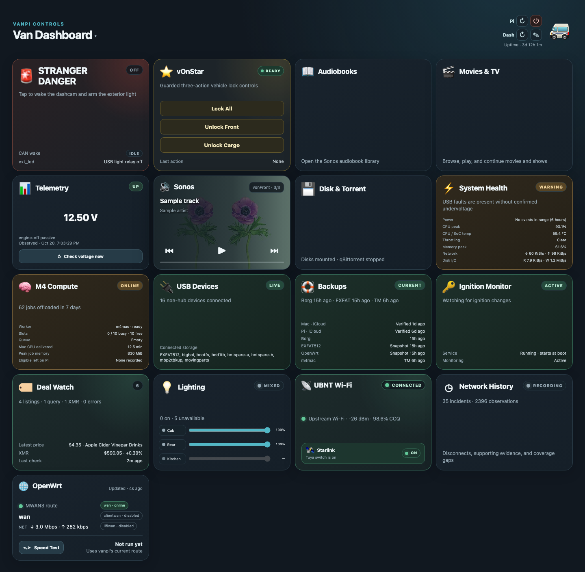
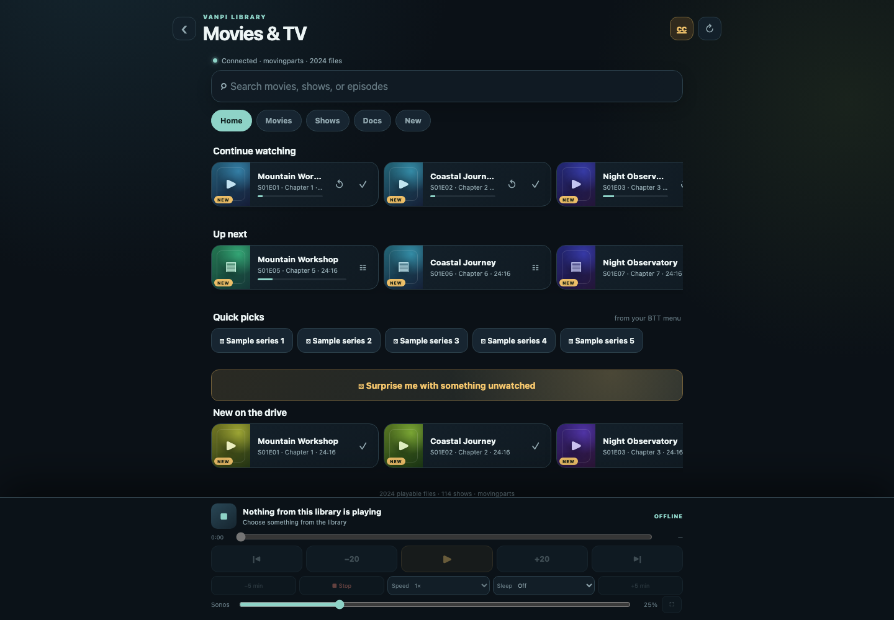
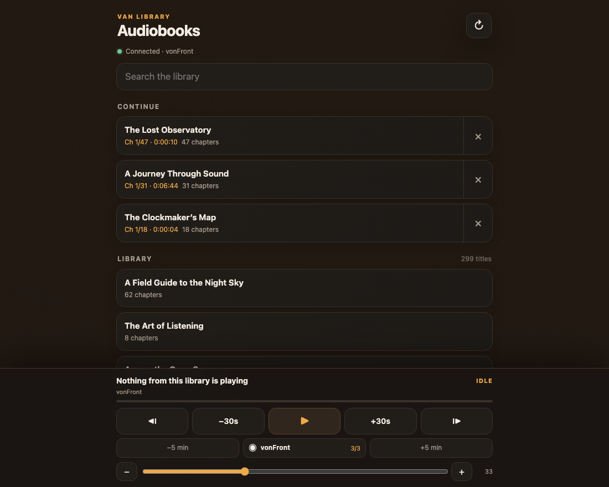
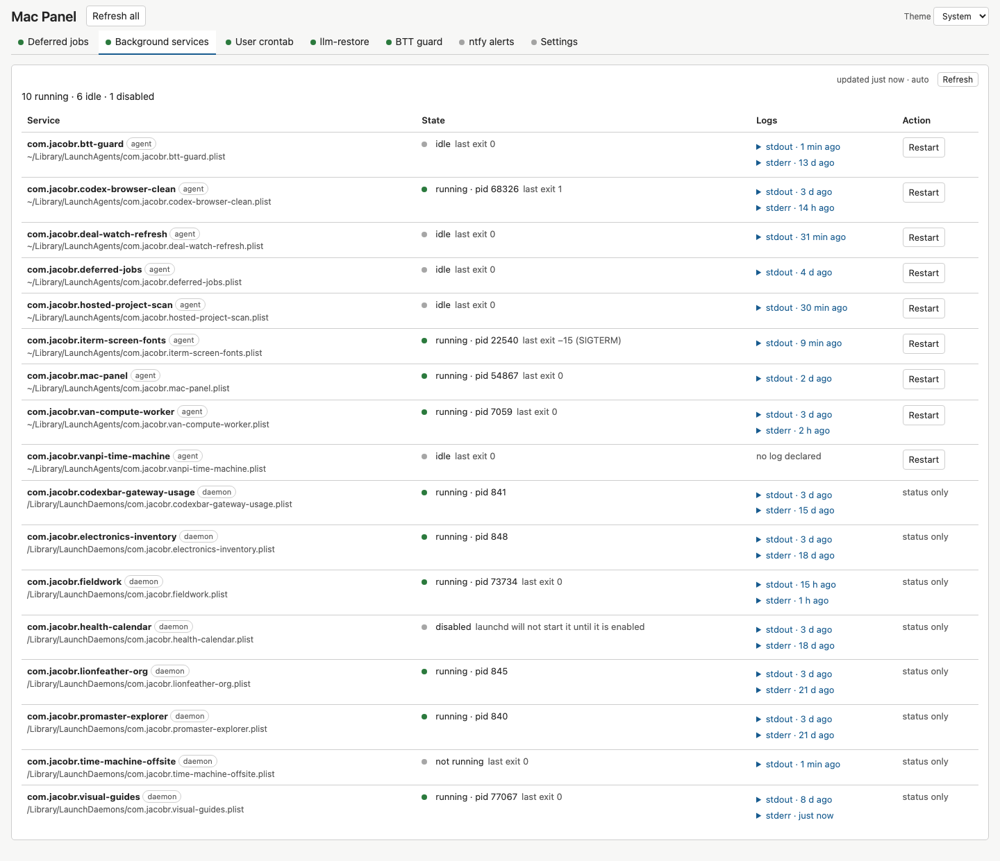

# Scripts and van apps

Personal tools for a campervan Raspberry Pi, its network and storage, and a MacBook.
The browser apps below share the service and deployment tooling in this repository.

## Van Dashboard

Vehicle and dashcam controls, Sonos, lighting, backup health, USB devices, compute
jobs, deal tracking and network history in one dashboard. Network and media labels
in this capture are anonymized; controls were not operated for the screenshot.



[Dashboard documentation](pi/docs/dashboard/VAN_DASHBOARD.md) ·
[React frontend](pi/docs/dashboard/REACT_DASHBOARD.md)

## Movies & TV

Continue watching, next episodes, quick picks and newly added media, with player,
subtitle, speed, sleep-timer and Sonos controls. Titles below are illustrative.



[Movies & TV documentation](pi/docs/media/VIDEO_LIBRARY.md)

## Audiobooks

Search the library, resume a chapter and control playback across grouped Sonos
speakers. Titles below are illustrative.



[Audiobook source](pi/apps/audiobooks/)

## Mac Panel

Local status and controls for background services, deferred jobs, crontab,
agent-session restoration, BTT guard, notifications and tool settings.



[Mac Panel documentation](macbook/mac_panel/README.md)

## Repository guides

- [Raspberry Pi apps, backups and deployment](pi/README.md)
- [MacBook utilities and BetterTouchTool](macbook/README.md)
- [Shared tools](shared/README.md)
- [OpenWrt configuration](vanrouter/README.md)
- [Directional Wi-Fi antenna](ubnt/README.md)

## Tests

Run the complete suite from the repository root:

```sh
.local/test-venv/bin/python run_tests.py
```

The runner stops on the first failure. Setup and platform-specific test requirements
are documented in [AGENTS.md](AGENTS.md#repository-test-suite).
